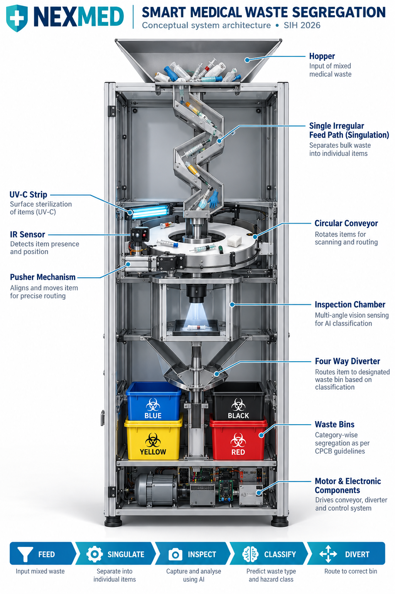

# NEXMED — Smart Medical-Waste Collection and Segregation System

NEXMED is a Smart India Hackathon project developed for **SIH26115: Design and Develop a Smart Mobile Medical-Waste Collection and Segregation System** (MedTech / BioTech / HealthTech; software category).

The project combines AI-based waste recognition, a web application with a 3D digital-twin interface, and a conceptual robotics design for automated medical-waste handling and routing. The proposed end-to-end system is intended to support safer segregation at the point of generation.

> **Prototype and safety notice:** NEXMED is a prototype and design project, not a certified medical or waste-management device. AI predictions and configured bin suggestions must not replace institutional biomedical-waste procedures, trained personnel, or applicable regulations. The robotics system was designed conceptually; a physical robotics prototype was not built.

## Project at a glance

- **Two trained AI models:** YOLO11s for object detection and MobileViT for image classification.
- **Sequential inference design:** YOLO11s detects an item, its bounding-box crop is passed to MobileViT, and MobileViT predicts the waste class.
- **Web application:** Flask backend and browser-based interface for image predictions and class-confidence details.
- **3D digital twin:** Interactive GLB assets representing system views and waste bins.
- **Robotics concept:** A proposed workflow for singulation, image capture, item orientation, mechanical routing, and disposal-event logging. This is a conceptual design, not a built physical machine.

## Problem statement

**SIH26115 — Design and Develop a Smart Mobile Medical-Waste Collection and Segregation System**

Manual biomedical-waste segregation can expose healthcare workers to hazardous materials and increase the chance of incorrect disposal. NEXMED explores an AI-assisted approach to identifying waste items and recommending a designated segregation category, alongside a concept for mobile and automated handling.

## System Architecture

The diagram below presents NEXMED's **conceptual end-to-end design**—from waste intake and singulation through AI-assisted inspection and classification to mechanical routing into designated bins. It illustrates the proposed machine architecture; the physical robotics system was not built.



For a more detailed breakdown of the software components and proposed robotics workflow, see [System Architecture](docs/system-architecture.md).

## How the AI pipeline works

The intended sequential pipeline uses both trained models:

1. **Image input:** The application receives an image containing a medical-waste item or items.
2. **YOLO11s object detection:** The trained YOLO11s detector locates waste objects and produces bounding boxes.
3. **Bounding-box crop:** The detected object region is cropped from the source image.
4. **MobileViT classification:** The crop is passed to the trained MobileViT classifier, which predicts one of the supported classes.
5. **Waste-to-bin mapping:** The predicted class is mapped to the prototype's configured destination.
6. **Results display:** The web interface presents the classification result and associated 3D bin visualization.

YOLO11s and MobileViT have distinct roles: **YOLO11s identifies where the object is; MobileViT classifies what the cropped object is.** See [System Architecture](docs/system-architecture.md) for the software and conceptual robotics workflow.

### Supported MobileViT classes

- `Cotton_Bandage`
- `Glove`
- `IV_Bottle`
- `Mask`
- `Pill_Strip`
- `Syringe`

### Prototype bin mapping

| Predicted class | Configured prototype destination |
|---|---|
| Cotton_Bandage | Yellow bin |
| Glove | Yellow bin |
| Mask | Yellow bin |
| IV_Bottle | Blue bin |
| Pill_Strip | Blue bin |
| Syringe | Red bin |

These are the prototype's configured mappings, not universal disposal instructions. Follow current local biomedical-waste rules and institutional procedures in real settings.

## Conceptual robotics workflow

The presentation describes the following proposed system flow:

```text
Waste input
   ↓
Singulation (separate items)
   ↓
Camera capture
   ↓
YOLO11s object detection
   ↓
Crop detected object → MobileViT classification
   ↓
Confidence / safety decision
   ↓
Mechanical routing to designated category
   ↓
Disposal event logging
```

The wider concept includes a mobile unit, sensing, feeder/receiver mechanisms, servo or DC motor routing, designated bins, a safety check, and digital compliance records. The team created a conceptual sketch / Autodesk Fusion 360 model, but the Fusion project file is not currently available and the physical robotics model was not built. Hardware operation, mechanical routing, UV-C disinfection, and autonomous mobility should therefore be treated as proposed design elements, not verified physical capabilities.

## Application features

- Image-based waste recognition using the project's trained AI models.
- Predicted class, confidence, and class-score display.
- Interactive 3D viewer with system-view and bin GLB assets.
- Flask backend with a health endpoint and image-prediction endpoint.
- Temporary-upload cleanup after inference.

## Repository structure

```text
NEXMED/
├── BioMedAI_Standalone_3D_BinTwin.html  # Web interface and 3D viewer
├── ExteriorView.glb                    # 3D model asset
├── SectionView.glb                      # 3D model asset
├── ExplodedView.glb                     # 3D model asset
├── bins/
│   ├── blackbin.glb
│   ├── bluebin.glb
│   ├── redbin.glb
│   └── yellowbin.glb
├── mobilevit/
│   └── mobilevit/                       # MobileViT checkpoint
└── backend/
    ├── app.py                           # Flask application / server entry point
    ├── routes.py                        # HTTP API endpoints
    ├── model_loader.py                  # MobileViT loading
    ├── predictor.py                     # MobileViT preprocessing / inference
    ├── config.py                        # Environment and path configuration
    ├── utils.py                         # Image validation and upload cleanup
    ├── requirements.txt
    ├── .env.example
    ├── logs/
    └── uploads/
```

The repository includes the MobileViT checkpoint and Flask application. The YOLO11s model weights and the full sequential YOLO-to-crop-to-MobileViT inference implementation should also be included in the repository for the published code to reproduce the complete pipeline described above. Do not assume the detector weights are present unless they have been added.

## Requirements

- Python **3.10 or newer**
- pip
- Internet access to install dependencies
- CPU for basic testing; compatible NVIDIA GPU may accelerate inference with an appropriate PyTorch/CUDA installation
- Modern browser with WebGL support for the 3D viewer

## Installation

### 1. Clone the repository

```bash
git clone https://github.com/yashas-1144/NEXMED.git
cd NEXMED
```

### 2. Create and activate a virtual environment

**Linux / macOS**

```bash
python3 -m venv .venv
source .venv/bin/activate
python -m pip install --upgrade pip
```

**Windows PowerShell**

```powershell
py -3 -m venv .venv
.venv\Scripts\Activate.ps1
python -m pip install --upgrade pip
```

### 3. Install backend dependencies

```bash
python -m pip install -r backend/requirements.txt
```

PyTorch installation options depend on your operating system and CPU/GPU setup. For CUDA, use the official [PyTorch installation selector](https://pytorch.org/get-started/locally/) to choose a compatible command.

### 4. Configure environment (optional)

The default configuration uses the checkpoint at `mobilevit/mobilevit/` and port `5000`. To override settings:

```bash
cp backend/.env.example backend/.env
```

Edit `backend/.env` if needed. Keep local secrets and machine-specific environment files out of version control.

## Run the application

From the repository root, with the virtual environment activated:

```bash
python backend/app.py
```

Then open:

- **Web app:** http://localhost:5000
- **Health endpoint:** http://localhost:5000/api/health

Open the interface through Flask rather than directly as a file URL so API endpoints and 3D assets can load.

## API reference

### `GET /api/health`

Checks that the backend is responding and reports whether its model is loaded.

```bash
curl http://localhost:5000/api/health
```

### `POST /api/predict`

Uploads an image as multipart form data with the field name `image`.

```bash
curl -X POST -F "image=@/path/to/image.jpg" http://localhost:5000/api/predict
```

The current documented backend response includes a predicted label, confidence percentage, and scores for the six MobileViT classes. Check the implementation in the repository for the exact response shape and the models currently wired into this endpoint.

## Model performance

The MobileViT checkpoint's recorded test accuracy is approximately **84.3%**. This is a metric recorded for the project's test run, not an independently verified benchmark. It should not be interpreted as proof of safe performance in clinical environments. No verified YOLO11s metrics are stated here because a reproducible evaluation report has not been documented in this repository.

Performance may vary with image quality, lighting, object appearance, occlusion, and differences between training images and real-world inputs. Confidence scores do not guarantee correctness.

## Limitations and responsible use

- NEXMED is a prototype/design project, not a certified medical or waste-management device.
- The physical robotics prototype was not built; the mechanical and mobile-system elements are conceptual.
- The classifier is limited to its supported classes; unknown objects may still receive incorrect predictions.
- The MobileViT test metric is a recorded project result, not an independently verified benchmark.
- Do not rely on AI output alone for real biomedical-waste handling.
- Bin recommendations must be checked against current local regulations and institutional procedures.
- The Flask development server and permissive CORS configuration are intended for local prototyping, not direct production deployment. Production use would require security hardening, access controls, monitoring, and extensive validation.

## License

No license is specified in this repository at present. Unless a license is added, others should not assume permission to reuse, distribute, or modify the project.
